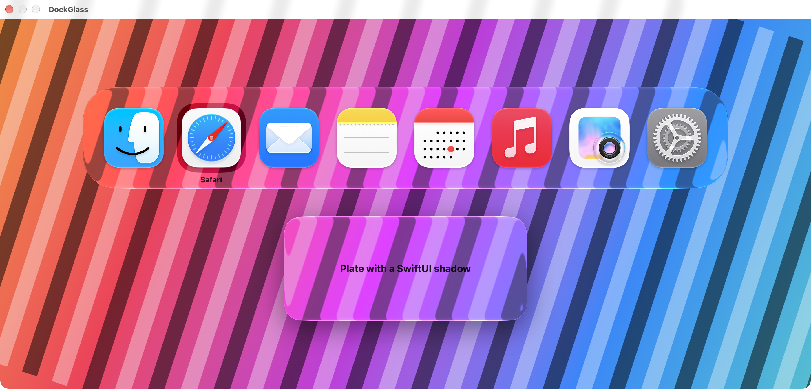
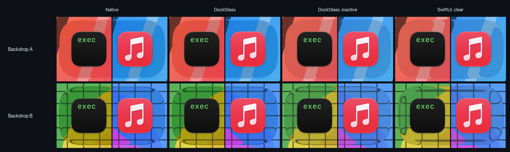
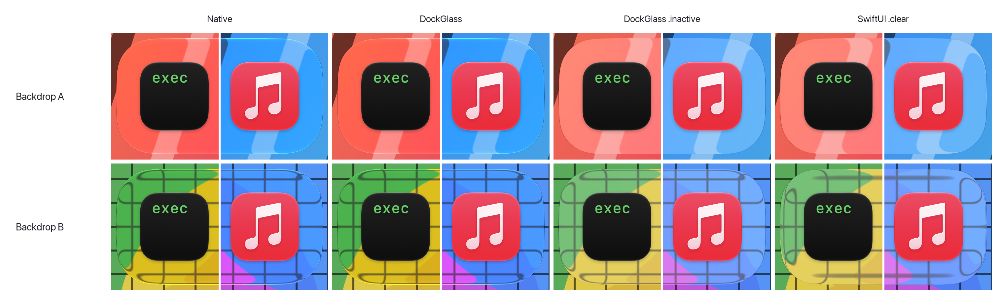
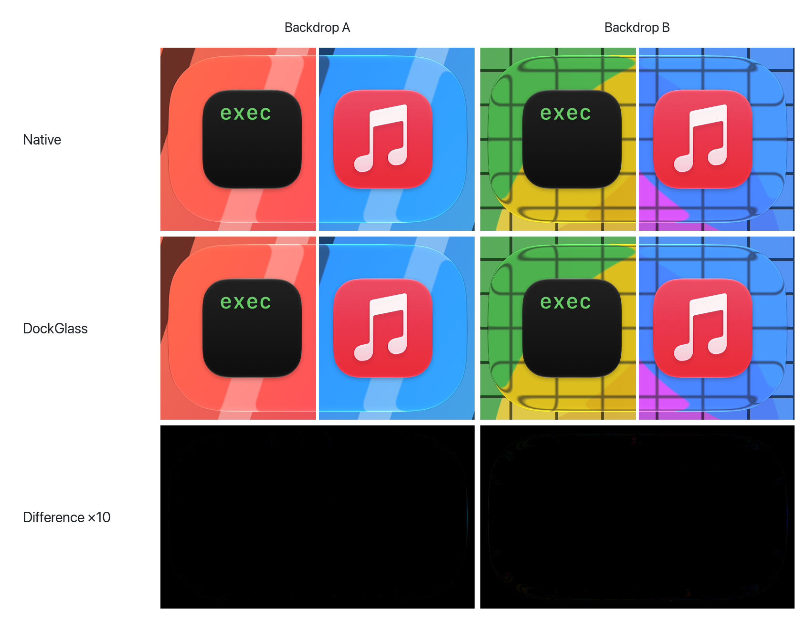
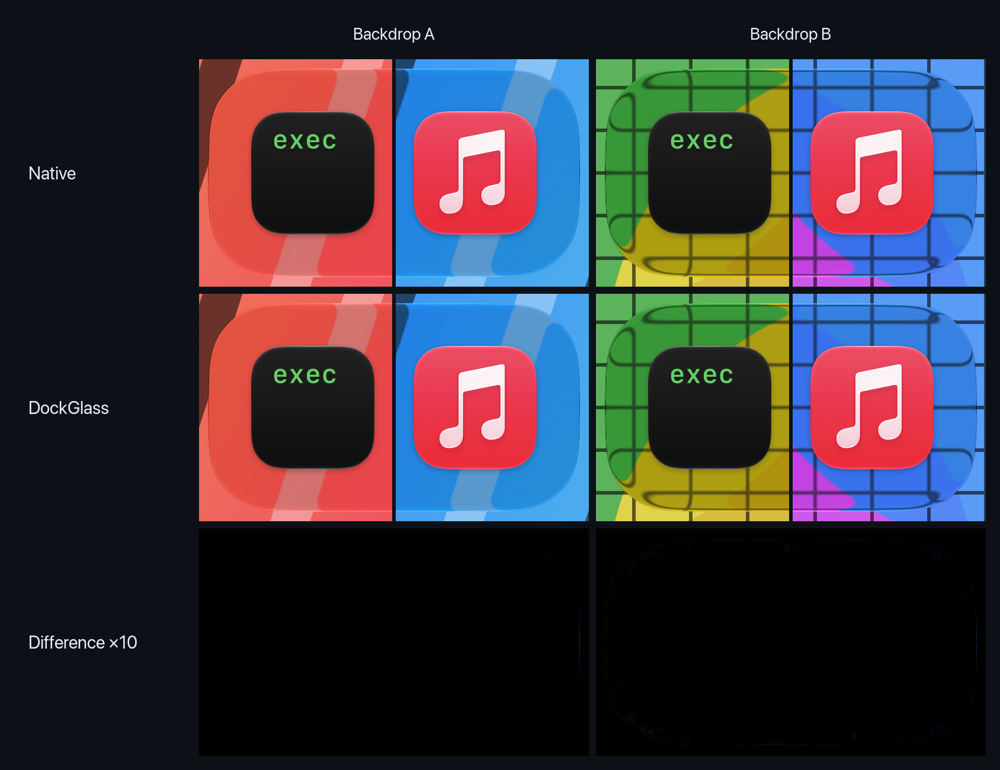
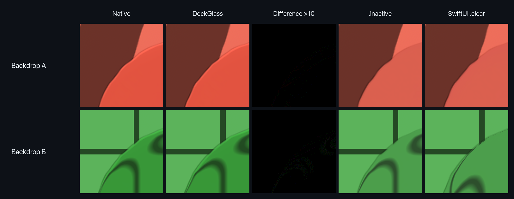
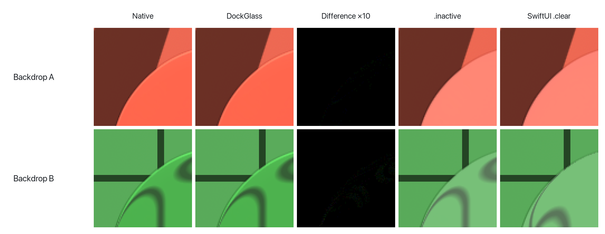
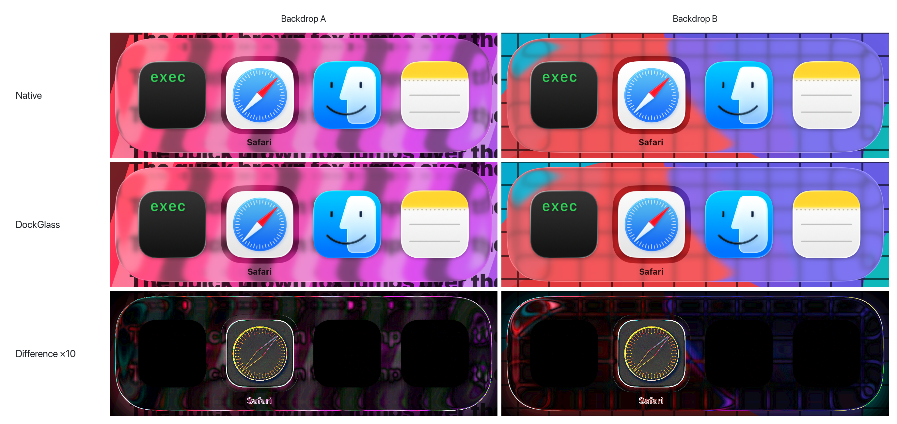
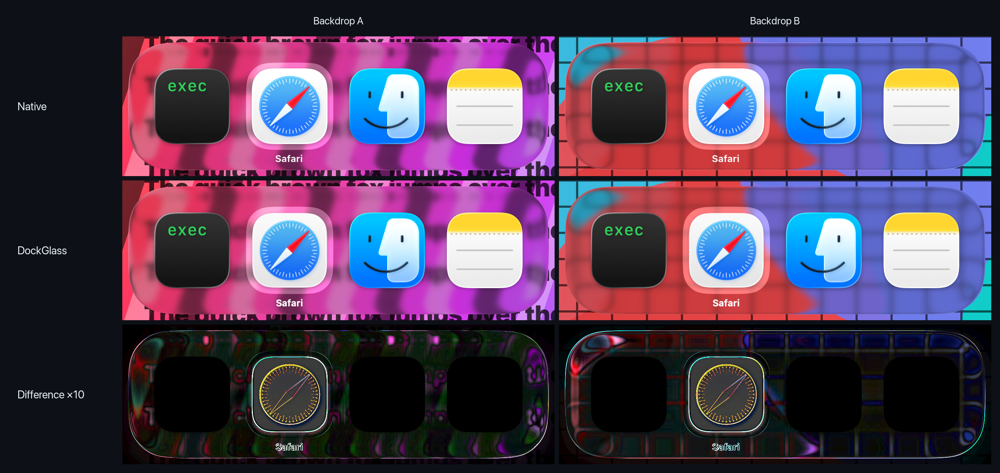
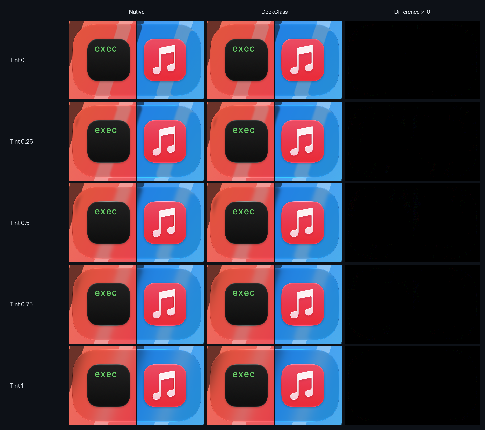

# DockGlass

SwiftUI glass and switcher chrome that match the macOS Dock and Cmd-Tab switcher on macOS 26 and
27, fitted pixel by pixel against each version's native switcher.

SwiftUI's public Liquid Glass offers `.regular` and `.clear`. Neither looks like the Dock or the
app switcher. On macOS 27 the switcher's material is SwiftUI's private Dock glass, drawn in the
*active* window state even though the Dock is never the active app. DockGlass draws that glass,
holds it in the active state whatever window hosts it, and corrects the one value the native
switcher changes (its edge band), so it keeps Apple's renderer, rim and all, and follows the
system's settings. Over the glass and its rim, the result matches the native switcher to within
about 0.1/255 on the fitting captures.

<picture>
  <source media="(prefers-color-scheme: dark)" srcset="media/demo-dark.png">
  
</picture>

This is not a dock widget. It reproduces the *material and geometry* of Apple's switcher plate,
which the Dock's own code calls a cartouche.

## Installation

Requires macOS 26 or later and Swift 6.2. Add DockGlass with Swift Package Manager:

```swift
dependencies: [
    .package(url: "https://github.com/thomplth/dock-glass.git", from: "0.3.0"),
],
targets: [
    .target(name: "YourApp", dependencies: [
        .product(name: "DockGlass", package: "dock-glass"),
    ]),
]
```

In Xcode, use File › Add Package Dependencies and enter the repository URL.

## Usage

```swift
import DockGlass

Cartouche {
    HStack(alignment: .top, spacing: DockGlass.Metrics.standard.iconSpacing) {
        ForEach(apps) { app in
            CartoucheIcon(app.icon, label: app.name, isSelected: app == selected)
        }
    }
}
```

Or put the glass behind any view:

```swift
content.dockGlass(in: RoundedRectangle(cornerRadius: 58, style: .continuous))
icon.dockGlassSelection(isSelected)
```

The glass, the highlight and the label are independent. Put the glass behind any layout, with
any UI on top, and use the highlight around any shape:

```swift
VStack { /* your own layout */ }
    .dockGlass(in: DockGlass.Metrics.standard.plateShape)

thumbnail
    .padding(DockGlass.Metrics.standard.selectionPadding)
    .dockGlassSelection(isSelected, in: RoundedRectangle(cornerRadius: 16, style: .continuous))

Text(title).dockGlassLabel(prominent: isSelected)
```

The highlight blends with the glass behind it, so keep shadows, `drawingGroup` and
`compositingGroup` off the views between the two.

### Style

`.dockGlassStyle(_:)` adjusts the fitted look for everything inside it. Each value is relative to
the native measurement, so `.native` (the default) is the native switcher:

```swift
.dockGlassStyle(DockGlassStyle(
    rimStrength: 1,          // the glass's specular rim; 0 hides it, up to 2 brightens it
    rimWidth: 1,             // how far the rim's light reaches in from the outline
    edgeRefraction: 1,       // how far the edges bend; 0 is flat
    selectionStrength: 1,    // highlight darkening (light) or lightening (dark); 0 hides it
    tint: .system,           // or .fixed(0...1) to ignore the Liquid Glass Tint setting
    focusState: .native      // or .active, .inactive, .matchWindow
))
```

### Focus state

macOS draws Liquid Glass differently in an inactive window: it hides the specular rim and blurs
and frosts the face. Glass in a non-activating panel, such as a switcher overlay, is always
inactive, while the same glass in a settings window is active while that window is key.
`focusState` decides which state DockGlass's glass draws in, for its own glass only.





Drawn inactive, the Dock glass loses its rim and frosts over (error 9.7 / 12.2 out of 255 against
native in dark mode, 20 / 27 in light), and SwiftUI's own `.clear` in an overlay is further off
still (15 / 19 dark, 25 / 31 light).


| | |
|---|---|
| `.native` (default) | The state the running system's look was fitted in: active on macOS 27, as the native switcher draws. Looks the same in every window. |
| `.active`, `.inactive` | Always that state, whatever the window. |
| `.matchWindow` | Follows the host window, like any other glass. |

Overriding the state uses a private SwiftUI value that DockGlass checks before use. Where it is
missing, `.native`, `.active` and `.inactive` fall back to stock glass and `DockGlass.status`
reports `.focusStateUnavailable`; `DockGlass.canOverrideFocusState` tells you up front.

`DockGlass.Metrics` carries the native geometry (176pt plate, 58pt continuous corner, 102pt
icons on a 134pt pitch with 37pt side padding, a 120pt selection square with a concentric 33pt
corner) and scales it to other icon sizes.

## Compared with native

Every figure below is a screen capture of the native Cmd-Tab switcher and of DockGlass's
`Cartouche` drawn in the same place over the same backdrop by `glass-fit`, with no other change.
The difference rows are the per-channel absolute difference, multiplied by 10 so that an error of
1/255 shows as 10/255. Errors are mean absolute per channel out of 255, measured on the whole
plate plus 6pt around it.

### macOS 27

The captures come from a 17-app switcher, so these figures show its two ends, joined at the seam:
the left end with glass-fit's own icon and the right end with Music. Between them sits the
selected icon, which the Dock resamples differently (about 8/255 inside its own box).





| macOS 27.0.1 | Glass | Rim (4pt band) | Whole plate, icons included |
|---|---|---|---|
| Light, backdrop A / B | 0.016 / 0.007 | 0.012 / 0.097 | 0.32 / 0.31 |
| Dark, backdrop A / B | 0.018 / 0.007 | 0.012 / 0.104 | 0.33 / 0.34 |

The rim is the system's own specular highlight, which only draws on active glass. Here is the
plate's top-left corner at 4×, beside the same glass drawn inactive and SwiftUI's `.clear`:





### macOS 26

macOS 26's switcher has the same geometry as 27's but a different material: it blurs slightly and
bends a wider band. DockGlass carries a separate look fitted against it, in a macOS 26.6.1 virtual
machine with stock apps only, so the whole plate shows. It is close but not identical: the
difference is visible at ×10 across the glass and around the selected icon.





| macOS 26.6.1 | Glass | Rim (4pt band) | Whole plate |
|---|---|---|---|
| Light, backdrop A / B | 2.18 / 1.66 | 4.27 / 3.73 | 2.90 / 2.43 |
| Dark, backdrop A / B | 2.24 / 2.34 | 2.56 / 3.34 | 2.45 / 2.60 |

## System settings

| Setting | Behaviour |
|---|---|
| Light and dark mode | Separate fitted tables; the selection highlight darkens in light mode and lightens in dark mode, as native does. |
| Liquid Glass Tint Amount (System Settings › Appearance) | Follows the native switcher's response, blur first and then the frosted fill, and updates live when the slider moves. SwiftUI's own Dock glass blurs less than native. |
| Reduce Transparency, Increase Contrast | DockGlass steps aside and shows the system's own glass. |



`DockGlass.status` reports whether tuned glass is showing, or why stock glass is showing instead.

## Caveats

DockGlass draws SwiftUI's private Dock glass, sets a private SwiftUI environment value to hold
the focus state, and writes to undocumented Core Animation filter and effect properties through
key-value coding. None of that is public API:

- **Not for the App Store.** App Review rejects non-public API use.
- **macOS updates can change it.** Unknown keys fail silently, so DockGlass checks every input
  it needs before tuning, looks private symbols up at run time and checks the focus switch
  works, and falls back to stock `.clear` glass when anything is missing. Each macOS
  version has its own fitted look (currently 26 and 27), because each version's switcher looks
  different; an unlisted version shows stock `.clear` glass.
- **The values are fitted, not designed.** They match the native switcher closely on the
  backdrops they were fitted over; see [Docs/FINDINGS.md](Docs/FINDINGS.md) for the method and the
  remaining differences.

## Refitting

`glass-fit` captures the native switcher over two test backdrops and searches for the tuning
that matches it best, rendering the real `Cartouche` while it searches:

```sh
swift run glass-fit capture captures/light
swift run glass-fit fit captures/light --apps self,<bundle id>,...
```

Both commands take over the screen while they run. Quit any app that replaces Cmd-Tab first.
`Tools/readme-media.sh` rebuilds the figures above from the captures and renders; its header
lists what each figure needs.
`swift run dockglass-demo` shows the component on its own.

## License

MIT
